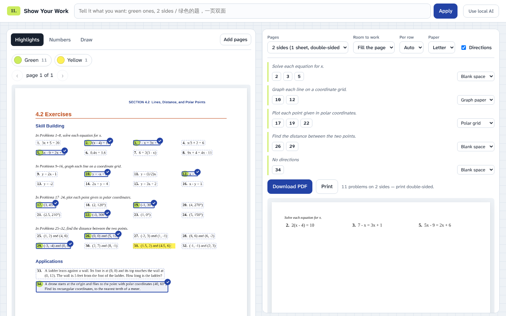

# Show Your Work

Drop in the textbook pages you marked up. Every highlighted problem is pulled out, the highlighter is cleaned off, and the problems are laid out as a plain exam sheet with room to work: no titles, no names, no logos. Everything runs in your browser; nothing is uploaded and there is no API key.



## Three ways to pick problems

- **Highlights.** Any highlighter color is found automatically: circles around numbers, swipes across a whole problem, ticks in the margin. Each color gets a chip (`Green 23`, `Orange 6`); the most-used color is selected when the file opens.
- **Numbers.** Type `11, 13, 15–21 odd`, `41–56 even`, or `第23题和第25题`.
- **Draw.** Drag a box around anything the finder missed. The box is trimmed to the ink.

Click any boxed problem on the page to add or remove it.

## The request box

Type what you want in plain English or Chinese:

> 请帮我把所有绿色的问题全部都提取出来……紧凑一些。一页double side。

becomes *23 green problems · 2 sides · fill the page*. Other examples: `remove 47 and 49`, `two columns, lots of room`, `polar grids for the plotting problems`, `A4`, `skip the directions`.

Requests are read instantly by a rule reader. Choose **Use local AI** to add a small language model, [Qwen3.5-0.8B](https://huggingface.co/onnx-community/Qwen3.5-0.8B-Text-ONNX), running in the browser on WebGPU with [Transformers.js](https://huggingface.co/docs/transformers.js). It downloads once (about 470 MB) and is cached. Without WebGPU the rule reader keeps working on its own. The model handles phrasing the rules don't know ("print it on European paper", "put three problems on each line"); every field it proposes is checked against the words in your request, so it can't invent problem numbers or change settings you didn't mention. On the 28-request test set in `tests/agent.eval.mjs`, the rule reader alone gets 20 exactly right, the model alone 12, and the two together all 28.

Explicit lists such as `Problems 43, 45, 57` always use the rule reader, even with Local AI on. Selection waits until the queued pages finish loading. If any requested numbers are missing, the app lists them in a warning and keeps the problems it could select.

## What the exam looks like

- Problems are the original pixels from the page, so every fraction, radical and figure is exactly as printed. Problem numbers line up on one baseline per row.
- Problems are grouped under their directions, with the "In Problems 11–18," prefix removed. Shared figures (the A/B/C/D graph for a matching set) come along once per group.
- Work areas follow the directions: polar grids for "plot … polar coordinates", graph paper for "graph" or "plot", answer lines for "match", and (a)/(b)/(c) lines when the directions list parts. Change any group's work area from its menu.
- **Pages** fits the sheet to 1, 2 (one sheet, double-sided), 3 or 4 sides, scaling problems between 75% and 125% and sharing the leftover room as writing space. **Fewest** uses as few sides as possible.
- Colored print (orange problem numbers, cyan arrows) is turned into dark gray for black-and-white printing.

## How it works

| Step | Where | How |
| --- | --- | --- |
| Read the page | `src/textlayer.js`, `src/ocr.js` | PDF text layer through PDF.js (with bold / italic / math-font detection). Scans and photos go through [tesseract.js](https://github.com/naptha/tesseract.js) at 300 dpi with highlighter removed first. |
| Find problems | `src/analyze.js` | Printed problem numbers, aligned plain exercise labels, directions lines (`In Problems 11–18, …`, `Exer. 43–44: …`), headings, and which text belongs to which problem, from word geometry. Works on grids of problems, two-column pages and multi-line word problems. |
| Find marks and figures | `src/raster.js` | Highlighter strokes: light, single-hue blobs that survive a morphological close/open. Figures: ink not covered by text. Crops grow to include fraction bars and radicals that touch the text. |
| Lay out | `src/layout.js` | Columns, baseline alignment, work aids and fitting to a page count. Pure functions, unit-tested. |
| Draw the PDF | `src/render-pdf.js` | pdf-lib. Polar and Cartesian grids are vector drawings. |
| Read requests | `src/rules.js`, `src/agent*.js` | Rule reader, local model in a Web Worker, and the evidence check that combines them. |

## Run it

### Download a release

Download `show-your-work-1.0.1.zip` from [GitHub Releases](https://github.com/sodium-qed/show-your-work/releases/latest), extract the complete folder, then run `npm start` inside it with Node.js 22.3.0 or newer. Open `http://localhost:4173`. The release includes the PDF libraries; no `npm install` is needed. Keep the extracted files together; opening `index.html` directly does not support the app's module loading.

### Run from source

It's a static site. Open the hosted copy, or run it locally:

```bash
npm install
npm start          # http://localhost:4173
```

Any static host works (GitHub Pages: Settings → Pages → Deploy from branch → `main` / root). PDF.js and pdf-lib are committed in `vendor/` (`npm run vendor` refreshes them). Tesseract.js, Transformers.js and the model weights load from public CDNs only when a page needs OCR or you turn on the local AI.

### Build a release

`npm run build` stages the complete runnable app in `dist/show-your-work-1.0.1/`. `npm run release:package` also creates the ZIP plus `dist/SHA256SUMS` (Python 3 required for packaging). Build from the release commit so `version.json` records its source revision. See [the release checklist](docs/RELEASING.md).

## Tests

```bash
npm test                                   # unit tests: numbers, request reader, page analysis, layout
npx playwright install chromium            # once
npm run test:e2e -- samples/sample.pdf 2,3,5,10,12,17,19,22,26,29,34
npm run test:selection                     # plain/split/glued labels, loading, missing-number feedback, PDF download
node tests/ai.e2e.mjs                      # local model in the browser (WebGPU; see the file for a CPU stand-in)
node tests/agent.eval.mjs rules            # request box scores; see the file for model runs
```

`npm run sample` regenerates `samples/sample.pdf`, an original exercise page with green circles and one yellow swipe.

## Limits

- Problems are found from their printed numbers (`12.`, `12)`) or plain labels supported by aligned numbering and exercise directions. Ambiguous numbers, lettered problems, or unnumbered prompts may need **Draw**.
- Photos should be reasonably flat and lit; strongly skewed pages may confuse OCR.
- Pages over 80 per file are not read.

MIT licensed.
