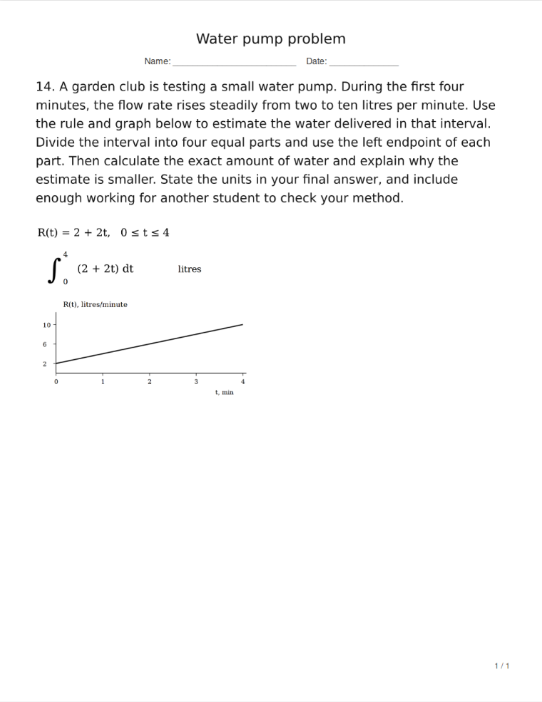

# Show Your Work

A tool that reformats math problems into clean, printable worksheets with space to write solutions 和 show work.

The app, called Margin, is an AI-free math worksheet studio packaged as a self-contained HTML file. Open it in a browser, select questions from PDFs or images, combine questions that span pages, and arrange them with blank writing space in a printable PDF. The print preview renders the same PDF bytes used for export.

## Open the HTML file

Download [`margin.html`](https://github.com/sodium-qed/show-your-work/raw/refs/heads/main/margin.html) (or open its GitHub file page and click **Download raw file**), then double-click it or use **Open file** in a supported modern Chromium browser, such as Chrome or Edge. The hosted copy also offers an **HTML file** download button. The downloaded file runs offline through `file://`. No installation, local server, account, API key, or internet connection is needed to use it.

The HTML is approximately **7.73 MiB** and embeds the application, PDF libraries, PDF worker, standard fonts, character maps, WebAssembly assets, and sample PDF. Keep the complete file when copying it to another computer.

The root `index.html` and `margin.html` are identical, committed standalone files. `src/index.html` is the development template. Builds regenerate both root files and their identical copies in `dist/`. The root is also ready for static hosting, including GitHub Pages; enabling Pages is a separate repository setting. No hosted GitHub Pages URL is assumed in this README.

## Develop or rebuild

Editing or rebuilding the application requires Node.js 22 or later and npm. From the source project directory:

```bash
npm ci
npm start
```

Open [http://localhost:4173](http://localhost:4173). Stop the server with `Ctrl+C`. `npm run dev` is an alias for `npm start`.

Build the distributable HTML and preview it over HTTP:

```bash
npm run build
npm run preview
```

The preview server also uses [http://localhost:4173](http://localhost:4173). Stop the development server first if it is already using that port. The build is written to `dist/`; each generated HTML entry point contains its runtime dependencies. Opening `dist/margin.html` directly also works without the preview server.

To regenerate only the standalone HTML package:

```bash
npm run build:html
```

The server binds to `localhost` by default. `PORT` and `HOST` can override the listen address; for example, `PORT=4174 npm start` on a POSIX shell. This is a static local development and preview server.

## Worksheet workflow

1. **Add a source.** Upload or drop one or more PDFs, PNGs, JPEGs, or WebP images. The bundled sample PDF provides a quick starting point. Use the source selector and page arrows to navigate.
2. **Select a question.** Drag a rectangle around the content to keep. Move the rectangle, resize it with its corner handles, or edit its percentage coordinates. Select a whole page when appropriate.
3. **Add or combine regions.** Add the crop as a problem. For a question spanning pages or files, select its problem card, navigate to the next part, and choose **Append to selected problem**. Each region retains its source reference for later crop edits.
4. **Arrange the worksheet.** Move problems and their regions up or down, remove unwanted content, and adjust each problem's scale and requested writing height. A manual page break starts a problem on a new page. Choose the paper size, margins, title, name/date line, page spacing, alignment, and optional worksheet numbers.
5. **Review suggestions when useful.** **Suggest questions** uses deterministic rules to find numbered headings in a PDF's text layer and propose crops. No AI model is involved. Review and adjust the proposed rectangles before adding them. Suggestions do not recognize scanned text or decide which surrounding content belongs to a question. See [extraction notes](docs/extraction.md).
6. **Preview and export.** Open **Print preview**, inspect every page and any layout warnings, then export the PDF. Edits invalidate the cached PDF; the next preview or export regenerates it. Print at **100% / Actual size** to preserve the intended dimensions.

Requested writing space is adjustable from 0 to 10 inches in quarter-inch steps. Scale ranges from 25% to 200%, with crops also constrained to the printable width. US Letter and A4 paper are supported, with 0.5, 0.75, or 1 inch margins. Worksheet titles are limited to 90 characters.

**100%** uses the source's original print size, subject to the printable width and any fit-to-page reduction. **30%** shrinks both dimensions to 30% of the original, making notation much smaller. **Reset to 100%** restores a problem's source scale and remembers 100% for future problems. Generated worksheet titles, labels, and page details use plain Arial/Helvetica styling; imported crops retain the source's original font appearance and notation.

**Page spacing** defaults to **Balanced**. After pagination, it shares spare page room evenly below complete problems, using the requested writing height as a minimum. It does not change crop size, proportions, or page count. **Compact** keeps the requested writing height exactly and leaves unused room at the bottom. The card field is labeled **Minimum space** in Balanced and **Writing space** in Compact. Pages containing a problem that continues across pages keep exact spacing in either mode.

**Centered** places all questions in one shared column, sized from the widest final crop in the worksheet. Every crop uses the same left edge, including narrower questions and continuation parts; crops keep their own sizes and are never stretched to fill the column. **Left aligned** places that shared edge at the page margin. Whitespace inside each crop remains part of the image, so tighten the manual crop if the visible text still starts unevenly.

Original numbers inside source crops remain visible. **Add worksheet numbers** is off by default, so the app adds no initial question label or reserved label space. Continuation pages use the neutral label **Continued**. Enable the checkbox to add sequential worksheet numbers; these are additional labels and never erase numbers already present in a crop.

With a new crop selected in **Select & arrange**, these keyboard shortcuts match the crop buttons:

| Key | Action |
| --- | --- |
| **P** | Add the current crop as a new problem |
| **Q** | Append the current crop to the selected problem |

Shortcuts are inactive while typing in a field, a dialog is open, processing is busy, print preview is showing, or an existing saved region is being edited. Appending requires a selected problem. Use **Update region** for saved-crop edits.

Ordinary problems stay together when their content and requested writing space fit a page. Larger problems continue onto subsequent pages with the requested writing height preserved exactly. **Fit to one page** shrinks question content when the requested writing space leaves enough room; it cannot make writing space longer than the usable page height fit on one page. Balanced spacing is applied afterward. Inspect the result for readability.

## Reflow dense directions

A source crop is an image: it keeps the original boldness, line breaks, and spacing inside the paragraph. **Page spacing** changes the blank room outside that image. To reformat prose directions:

1. Draw a new selection around only the directions on a PDF page and choose **Reflow selected text**.
2. Review and edit the extracted words, symbols, and reading order. Choose **New problem** or **Append to selected problem**, then confirm with **Add problem** or **Append text**.
3. Keep that problem selected, crop the original equation or diagram, and press **Q** to append it. The mathematical notation remains in its source image.



*Reviewed, normal-weight directions with the original equation and graph preserved.*

The prose uses normal-weight text and wraps to the current paper's printable width when saved, before the problem's scale is applied. A new reflowed problem starts at **100%** with **Continue onto next page**, keeping the remembered writing-height and page-break defaults. Appending or reopening a saved region with **Edit text** keeps the existing card's settings, including its scale; **Save text** confirms an edit. Ordinary pasted-text problems inherit all new-problem defaults.

Changing paper size or margins does not automatically rewrap saved text. Use **Edit text**, then **Save text**, to regenerate it at the new printable width.

Reflow uses an existing PDF text layer, with no AI or OCR. For images and scans without usable text, type the directions into the text dialog. This is not automatic mathematics typesetting: keep fractions, superscripts, equations, and diagrams as crops when their layout matters. Reflow does not remove prose already inside another crop; remove or recrop duplicate directions after reviewing the replacement.

## Remembered settings

Changing a problem's writing height, scale, overflow mode, or page-break setting remembers that field as the default for future problems, including suggested and pasted-text problems. The worksheet title, paper, margins, name/date line, **Page spacing**, alignment, and **Add worksheet numbers** choice are also remembered across refreshes in this browser's `localStorage`, when available. The settings status shows the next-problem defaults and whether they were saved on this device. On desktop, worksheet settings remain visible while the problem list scrolls.

**Reset saved settings** restores worksheet preferences and defaults for new problems. Existing crops, ordering, and per-problem settings remain intact. Files, problem cards, and pasted question content are held only in memory and disappear on refresh; export the PDF before leaving. If browser storage is unavailable or cleared, saved preferences will not survive a new session.

## Supported content and limits

- **Text PDFs and scanned PDFs:** manual crops preserve the visible notation, diagrams, and layout. Numbered-question suggestions and prose extraction require a usable existing PDF text layer.
- **Images:** PNG, JPEG, and WebP are supported. Standalone images are treated as 300 dpi and constrained to Letter content width before worksheet scaling.
- **Pasted and reflowed text:** reviewed plain text, paragraph breaks, and Unicode symbols are rendered with available system fonts. This is not a LaTeX, MathML, or equation parser. Use an image or PDF crop for typeset fractions, complex notation, or diagrams. Glyph coverage depends on the browser's fonts.
- **Size limits:** 50 MB per file, 500 pages per imported PDF, and 50 megapixels per image. Generated worksheets are also limited to 500 pages. Password-protected PDFs must be unlocked before import. Text entry is limited to 6,000 characters in the interface and may need splitting if the rendered result is too large. Image dimensions are checked after browser decoding, so very large inputs can still require substantial memory.
- **Raster export:** source crops and text regions are embedded as PNG images. Continuation pages clip and reuse the same embedded crop instead of resampling separate slices. Question content, including reviewed prose, is not retained as selectable or searchable PDF text. Worksheet labels and page numbers remain PDF text.
- **Print quality:** crops target 300 dpi, subject to a 20 million pixel and 14,000 pixel side limit. Low-resolution source material cannot gain detail through enlargement. Large crops may use a lower rendering resolution. Warnings use the estimated resolution at the final print size, including available scan-image density and enlargement; inspect the actual source for sharpness.
- **Large previews:** screen previews share a 48 million pixel budget. Very long worksheets therefore display at a lower preview resolution with a notice. This changes only the on-screen rendering, not the exported PDF's crop resolution.
- **Oversized crops:** the layout prefers whitespace when splitting a tall crop across pages, but may cut through content when no suitable whitespace is available. Split the source into smaller regions, reduce scale, or use **Fit to one page** as appropriate.
- **Session lifetime:** imported sources, selections, and problem cards are held in memory and cleared on refresh or tab closure. Only worksheet preferences and defaults are saved locally. There is no project save/reopen format.

There is no AI model, AI service, or OCR implementation. Manual selection, reviewed text, and ordinary text-layer rules provide the complete workflow, including PDF export. Scans without an existing text layer use manual crops or manually typed prose.

## Privacy and dependencies

Selected files and pasted text are processed in the browser. Only the preferences described above are stored in `localStorage`; source files, crop images, and problem text are not saved there. The application has no upload endpoint, account system, analytics, cloud inference, or API-key requirement. In the standalone HTML, PDF.js, pdf-lib, and their runtime assets are embedded; no CDN, remote font, external script, or server request is required. The hosted copy uses the same browser-side processing, without sending the selected files to a server.

Installing development dependencies with `npm ci` requires access to the npm registry unless the packages are already cached. This installation step applies to source development and rebuilding, not to opening the downloaded HTML.

The application uses:

- [`pdfjs-dist`](https://github.com/mozilla/pdf.js) to render source documents and the generated preview, and to read PDF text layers for suggestions.
- [`pdf-lib`](https://github.com/Hopding/pdf-lib) to assemble exported PDFs.
- [`playwright`](https://playwright.dev/) for browser integration checks.

Dependency versions are pinned in `package.json` and `package-lock.json`.

## Source map

| Path | Responsibility |
| --- | --- |
| `index.html`, `margin.html` | Identical standalone HTML distributions |
| `src/index.html`, `styles.css` | Editable interface template and styling |
| `src/app.js` | Workspace state, source navigation, crop controls, problem editing, preview, and download |
| `src/preferences.js` | Validated worksheet preferences and new-problem defaults in browser storage |
| `src/pdf-engine.js` | Source loading, canvas rendering, cropped assets, text rendering, PDF export, and preview rendering |
| `src/layout.js` | Page layout and writing-space allocation in PDF points |
| `src/detection.js` | Conservative suggestions from numbered PDF text |
| `src/text-extraction.js` | A reviewable prose draft from selected PDF text, with boundary and reading-order warnings |
| `scripts/serve.mjs` | Local static development and build-preview server |
| `scripts/build.mjs` | Rebuilds standalone HTML for download and static hosting |
| `scripts/build-html.mjs` | Packages the source modules, PDF libraries, worker, resources, sample, and license notices into standalone HTML |
| `public/samples/` | Bundled demonstration material |
| `tests/` | Automated layout, extraction, and browser checks |

## Verification

```bash
npm test
npm run test:e2e
npm run test:ui
npm run test:text
```

Browser checks require a compatible Playwright Chromium installation. See [testing notes](docs/testing.md) for setup, coverage, and recorded results. Source extraction behavior and limits are documented in [extraction notes](docs/extraction.md).

## License

Project code is covered by the existing [MIT license](LICENSE). Embedded third-party dependencies retain their own license notices inside each standalone HTML file.
